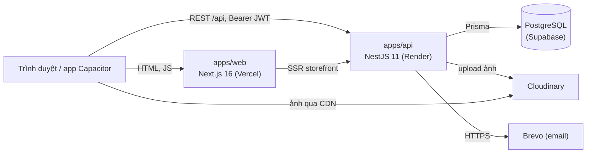

# Kiến trúc

## 1. Tổng quan



- Frontend và API ở **hai origin khác nhau**. Trình duyệt gọi thẳng API (CORS chỉ cho phép `FRONTEND_URL`, `NEXT_PUBLIC_APP_URL` và `http://localhost:3000`).
- Token lưu trong `localStorage` và gửi qua header `Authorization: Bearer`, không dùng cookie. Vì vậy server Next.js không biết ai đang đăng nhập: dashboard và trang đơn của người mua được bảo vệ ở phía client, còn API là lớp kiểm tra quyền thực sự.
- Backend là nguồn sự thật cho dữ liệu, luật nghiệp vụ, phân quyền và kiểm tra cuối. Frontend lặp lại một số luật (ví dụ các trạng thái đơn được chuyển tiếp, lý do huỷ) chỉ để phản hồi nhanh.

## 2. Monorepo

```
marketup/
├── apps/
│   ├── web/                 # Next.js: dashboard người bán + storefront + trang đơn người mua
│   └── api/                 # NestJS REST API
├── packages/
│   └── database/            # Prisma schema, migrations, seed, Prisma client dùng chung
├── docs/                    # Tài liệu chi tiết
├── .github/workflows/ci.yml # CI: lint → type-check + test → build → Docker
├── docker-compose.yml       # PostgreSQL + Adminer cho local
└── docker-compose.prod.yml  # Chạy cả stack bằng Docker (tự host)
```

- Quản lý bằng **pnpm workspaces** + **Turborepo** (`turbo.json`). `postinstall` ở root chạy `prisma generate`.
- File `.env` duy nhất ở thư mục gốc; API và các script Prisma đều đọc từ đó.

## 3. Frontend (`apps/web`)

### 3.1 Công nghệ

Next.js 16 (App Router, `output: 'standalone'`), React 19, Tailwind CSS 4, shadcn/ui, TanStack Query 5 (server state), Zustand (client state), React Hook Form + Zod (form), Recharts (biểu đồ), Axios, Capacitor 8.

Quy ước giao diện:

- Component từ shadcn/ui (`components/ui`, style `base-nova` trên Base UI). Thêm component bằng `npx shadcn add`, hoặc lấy từ registry `https://ui.shadcn.com/r/styles/base-nova/<tên>.json` nếu máy không có pnpm.
- Dùng màu của theme (`bg-card`, `text-muted-foreground`, `bg-primary`…), không viết cứng màu (`bg-white`, `text-gray-*`). Riêng lớp phủ tối trên ảnh được dùng `bg-black/60`.
- Storefront: `brandThemeStyle()` (`components/shop/brand-theme.ts`) đặt màu thương hiệu thành `--primary` ở layout của shop và ở khung xem trước, nên mọi `Button`/`FilterChip`/`bg-primary` bên trong tự theo màu shop.
- Bo góc: nút/ô nhập `rounded-lg`, thẻ/khung `rounded-xl`, nhãn/nút lọc `rounded-full`.
- Dùng chung: `SearchInput`, `EmptyState`, `FilterChip`, `ReviewItem`/`ReviewSummary`, `StorefrontPreview`.
- Skeleton phải trùng bố cục trang thật để không giật khi dữ liệu về: dùng cùng khung (card, padding, grid), mỗi hàng cao bằng line-height của chữ thật (bọc ô skeleton trong `flex h-5`/`h-[1lh]`), chữ tĩnh (tiêu đề, nhãn) hiện thật. Skeleton của một component đặt cạnh component đó (`StatCardSkeleton`, `ReviewItemSkeleton`, `OrderProgressSkeleton`…).
- `loading.tsx` / skeleton không gọi `useQuery` cho dữ liệu mà page tải sẵn ở server (chỉ đọc cache bằng `getQueryData`): query rỗng tạo trong fallback khiến `HydrationBoundary` của page hoãn nạp dữ liệu → server render thiếu → lỗi hydration.
- Dải tab/chip hẹp: vuốt ngang trên một hàng với `overflow-x-auto scrollbar-none` (utility trong `globals.css`).
- Dashboard: từ `md` sidebar chiếm chỗ (màn 768px chỉ còn ~450px nội dung), nên lưới/bảng/thanh công cụ trong trang chia cột theo bề rộng vùng nội dung (`@container` ở layout hoặc card, biến thể `@xl:`/`@3xl:`), không theo bề rộng màn hình (`sm:`/`md:`).

### 3.2 Nhóm route

| Nhóm          | Đường dẫn                                                                    | Render                                                                             |
| ------------- | ---------------------------------------------------------------------------- | ---------------------------------------------------------------------------------- |
| `(auth)`      | `/login`, `/register`                                                        | Client                                                                             |
| `setup`       | `/setup`                                                                     | Client, cần đăng nhập                                                              |
| `(dashboard)` | `/dashboard`, `/products`, `/categories`, `/orders`, `/reviews`, `/settings` | Client; layout chuyển về `/login` nếu chưa đăng nhập, về `/setup` nếu chưa có shop |
| `shop/[slug]` | storefront, trang sản phẩm                                                   | **SSR** + `generateMetadata` (Open Graph)                                          |
| `shop/[slug]` | `checkout`, `order-success`, `orders`, `orders/[orderNumber]`                | Client; trang đơn đặt `noindex`                                                    |

### 3.3 Storefront SSR

- `lib/storefront-server.ts` gọi API từ server với **timeout 3 giây** và `cache: 'no-store'` (giá và tồn kho phải luôn mới).
- API trên Render có thể đang khởi động lại (cold start). Quá 3 giây thì server trả HTML không kèm dữ liệu và Client Component tự fetch lại, nên trang không bị treo.
- Dữ liệu SSR được truyền vào TanStack Query (`lib/storefront-queries.ts`) để client không phải fetch lại.
- Shop không tồn tại: `notFound()` được gọi trong **layout** chứ không trong page, vì `loading.tsx` của page đã gửi HTTP 200 trước khi page chạy. Gọi ở layout mới trả được 404 thật.

### 3.4 State phía client

| Store                        | Khoá `localStorage` | Nội dung                                     |
| ---------------------------- | ------------------- | -------------------------------------------- |
| `hooks/use-auth.ts`          | `auth-storage`      | Token và thông tin người bán                 |
| `hooks/use-buyer-session.ts` | `buyer-session`     | Phiên người mua (email + token, 30 ngày)     |
| `hooks/use-cart.ts`          | `cart-storage`      | Giỏ hàng, mỗi shop một giỏ (`carts[shopId]`) |

`lib/api-client.ts` tự gắn token người bán vào mọi request, **trừ khi** request đã có header `Authorization` riêng. API phía người mua (`lib/buyer-api.ts`) luôn tự gửi token của mình: link token của đơn, hoặc phiên người mua.

### 3.5 Ảnh

- Ảnh người bán upload nằm trên Cloudinary; ảnh mẫu trong seed lấy từ Unsplash.
- `components/remote-image.tsx` dùng loader riêng (`lib/image-loader.ts`) để resize bằng CDN của chính nguồn ảnh: Cloudinary chèn `f_auto,q_auto,w_<width>`, Unsplash dùng tham số `w`, `q`, `auto=format`. Cách này không dùng Image Optimization của Vercel (bị giới hạn và tính phí theo ảnh). Nguồn ảnh khác thì hiển thị nguyên bản.

### 3.6 Header bảo mật

`next.config.ts` đặt cho mọi trang: Content-Security-Policy (chỉ cho `connect-src` tới origin của API), `X-Frame-Options: DENY`, `X-Content-Type-Options: nosniff`, `Cross-Origin-Opener-Policy`, HSTS. Ở môi trường development CSP cho phép thêm `unsafe-eval` để React dựng lại call stack.

### 3.7 App di động (Capacitor)

`capacitor.config.ts` cấu hình app `vn.marketup.app` là một WebView trỏ thẳng tới bản web production (`server.url`). Thư mục `www/` chỉ là trang giữ chỗ bắt buộc của Capacitor. App luôn chạy bản web mới nhất, không cần build tĩnh. Hai thư mục native `android/` và `ios/` không được commit.

## 4. Backend (`apps/api`)

### 4.1 Module

| Module            | Trách nhiệm                                                                                            |
| ----------------- | ------------------------------------------------------------------------------------------------------ |
| `AuthModule`      | Đăng ký/đăng nhập người bán, `AccessTokenService` ký và kiểm tra mọi loại token, các guard             |
| `BuyerAuthModule` | Gửi và kiểm tra mã đăng nhập 6 số cho người mua                                                        |
| `ShopModule`      | Tạo/sửa shop, storefront công khai theo slug                                                           |
| `ProductModule`   | CRUD sản phẩm, thuộc tính, biến thể, upload ảnh                                                        |
| `CategoryModule`  | Danh mục theo shop                                                                                     |
| `OrderModule`     | Đặt hàng, đổi trạng thái, huỷ đơn; API người mua `/buyer/orders`                                       |
| `ReviewModule`    | Đánh giá công khai, người mua viết/sửa, người bán xem/trả lời                                          |
| `DashboardModule` | Thống kê cho người bán                                                                                 |
| `UploadModule`    | Upload ảnh lẻ lên Cloudinary (banner, logo)                                                            |
| `MailModule`      | Gửi email qua Brevo (API HTTPS) hoặc SMTP (`mail/mail-transport.ts`); không cấu hình thì chỉ in ra log |
| `PrismaModule`    | Prisma client dùng chung                                                                               |

Code thuần (không phụ thuộc Nest) được tách thành file riêng kèm unit test: `order/order-status.ts`, `order/order-number.ts`, `review/review-rules.ts`, `dashboard/revenue-trend.ts`, `buyer-auth/login-code.ts`, `common/cloudinary-url.ts`, `common/slug.ts`, `common/html.ts`, `product/product-payload.ts`, `config/env.validation.ts`.

### 4.2 Token và phân quyền

Mọi token là JWT ký bằng cùng `JWT_SECRET`, phân biệt bằng claim `typ`:

| `typ`    | `sub`    | Hạn dùng                       | Cấp khi                                    | Mở được                                        |
| -------- | -------- | ------------------------------ | ------------------------------------------ | ---------------------------------------------- |
| `seller` | user id  | `JWT_EXPIRES_IN` (mặc định 7d) | Đăng nhập/đăng ký người bán                | Mọi API quản lý của shop mình                  |
| `buyer`  | email    | 30 ngày                        | Nhập đúng mã email                         | Mọi đơn của email đó (theo từng shop)          |
| `order`  | order id | 180 ngày                       | Đặt hàng xong; có trong link mọi email đơn | Đúng một đơn: xem, huỷ khi `PENDING`, đánh giá |

Guard:

- `JwtAuthGuard` (Passport `JwtStrategy`): chỉ nhận token `seller`. Các service còn kiểm tra thêm shop đó có thuộc người gọi hay không.
- `BuyerSessionGuard`: chỉ nhận token `buyer` (danh sách "My orders").
- `OrderAccessGuard`: nhận `buyer` hoặc `order`. `order/buyer-order-access.ts` đổi quyền truy cập thành điều kiện truy vấn: `buyer` → `orderNumber + buyerEmail`; `order` → `orderNumber + id`.

Token của đơn cố ý **không** phải phiên đăng nhập: ai cũng có thể gõ email người khác khi đặt hàng, nên chỉ việc chứng minh sở hữu email (qua mã) mới mở được danh sách đơn.

### 4.3 Kiểm tra dữ liệu và lỗi

- `ValidationPipe` toàn cục với `whitelist` + `forbidNonWhitelisted`: trường lạ bị từ chối với 400. DTO dùng class-validator; email được trim và chuyển chữ thường (`common/email.ts`).
- Sản phẩm gửi dạng multipart, nên `attributes`/`variants` là chuỗi JSON; `product/product-payload.ts` parse và validate từng phần tử.
- `PrismaExceptionFilter` đổi lỗi ràng buộc của Prisma thành mã HTTP dễ hiểu: trùng unique → 409, không tìm thấy bản ghi → 404, khoá ngoại sai → 400.
- Thông báo lỗi bằng tiếng Anh; frontend hiển thị nguyên văn `message` (`getErrorMessage`).

### 4.4 Tính đúng khi chạy đồng thời

| Tình huống                               | Cách xử lý                                                                    |
| ---------------------------------------- | ----------------------------------------------------------------------------- |
| Hai đơn mua món cuối cùng cùng lúc       | `updateMany where stock >= qty` trong transaction; count 0 → 400              |
| Người mua huỷ đúng lúc shop xác nhận     | Cập nhật có điều kiện `where {id, status: trạng thái vừa đọc}`; count 0 → 409 |
| Hoàn kho hai lần khi huỷ                 | Cùng điều kiện trên, nên chỉ một lần huỷ thành công                           |
| Đoán mã OTP bằng nhiều request song song | Tăng `attempts` nguyên tử trước khi so mã                                     |
| Dùng một mã OTP hai lần                  | `updateMany where consumedAt = null`                                          |
| Sửa đánh giá hai lần song song           | `updateMany where editedAt = null`                                            |
| Hai đánh giá cho cùng một món            | Unique `reviews.orderItemId` → 409                                            |

### 4.5 Giới hạn tần suất

`@nestjs/throttler`, đếm theo IP (`common/rate-limit.ts`):

| Hành động                      | Giới hạn       |
| ------------------------------ | -------------- |
| Đăng nhập người bán            | 10 / phút      |
| Đăng ký                        | 5 / phút       |
| Gửi mã đăng nhập người mua     | 5 / phút       |
| Kiểm tra mã đăng nhập          | 10 / phút      |
| Đặt hàng                       | 20 / phút      |
| Viết/sửa đánh giá              | 10 / phút      |
| Mọi request ghi khác           | 300 / phút     |
| Request đọc (GET/HEAD/OPTIONS) | Không giới hạn |

Request đọc không bị giới hạn vì SSR storefront gọi API từ một số ít IP server Vercel dùng chung cho mọi khách; giới hạn theo IP sẽ chặn cả trang.

IP người dùng lấy từ `X-Forwarded-For`, tính từ phải sang đúng `TRUST_PROXY_HOPS` lớp proxy. Đặt thiếu thì mọi người dùng chung IP của proxy; đặt thừa thì client gửi header giả để lách giới hạn. Cách đo: xem [Triển khai](deployment.md#trust_proxy_hops).

`RATE_LIMIT_DISABLED=true` tắt toàn bộ giới hạn. Chỉ dùng khi chạy bộ test tự động ở local, không bao giờ bật trên server.

### 4.6 Biến môi trường được kiểm tra khi khởi động

`config/env.validation.ts` dừng API ngay khi:

- thiếu `DATABASE_URL`;
- `JWT_SECRET` ngắn hơn 32 ký tự hoặc là chuỗi mẫu đã từng có trong repo;
- `TRUST_PROXY_HOPS` không phải số nguyên.
