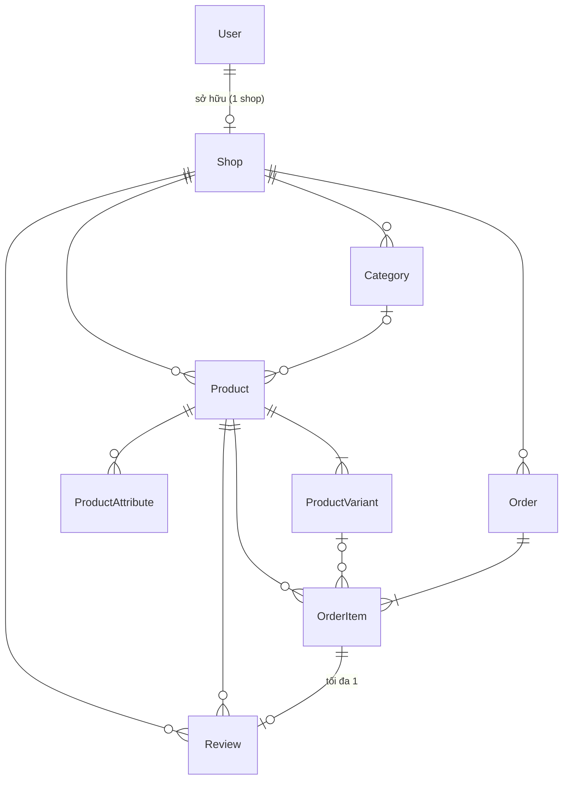

# Mô hình dữ liệu

Schema: [`packages/database/prisma/schema.prisma`](../packages/database/prisma/schema.prisma). Migration: `packages/database/prisma/migrations/` (bắt đầu từ một migration duy nhất `0_init`).

## 1. Sơ đồ quan hệ

`BuyerLoginCode` đứng riêng, không có quan hệ: người mua không có tài khoản, chỉ được nhận diện bằng email.

## 2. Các bảng

### `users`: người bán

| Cột            | Ghi chú                                      |
| -------------- | -------------------------------------------- |
| `email`        | Unique, chữ thường                           |
| `passwordHash` | bcrypt; không bao giờ trả về client          |
| `role`         | `SELLER` (mặc định) hoặc `ADMIN` (chưa dùng) |

### `shops`

| Cột                                       | Ghi chú                                                                   |
| ----------------------------------------- | ------------------------------------------------------------------------- |
| `slug`                                    | Unique, không đổi được sau khi tạo                                        |
| `ownerId`                                 | Unique, nên mỗi người bán có đúng một shop                                |
| `logoUrl`, `bannerUrl`                    | Chỉ ảnh Cloudinary của MarketUp hoặc rỗng                                 |
| `bannerFocusX`, `bannerFocusY`            | Phần ảnh banner giữ lại khi bị cắt vừa khung (0–100%, mặc định 50 = giữa) |
| `bannerZoom`                              | Phóng to ảnh banner quanh điểm trên (100–200%, mặc định 100 = vừa khung)  |
| `primaryColor`                            | Mã màu hex, mặc định `#111111`                                            |
| `contactEmail`, `contactPhone`, `address` | Hiển thị trên storefront                                                  |
| `isActive`                                | `false` thì storefront trả 404 và không đặt hàng được                     |

API công khai chỉ trả các trường hiển thị, không trả `ownerId`.

### `categories`

Unique `(shopId, slug)`. Xoá danh mục thì `products.categoryId` thành `NULL`.

### `products`, `product_attributes`, `product_variants`

- `products.imageUrl` là ảnh đại diện; `images` là mảng URL.
- `isVisible = false`: ẩn khỏi storefront, không đặt được, đánh giá không được tính. Sản phẩm đã có đơn chỉ được ẩn, không xoá được (`order_items.productId` là `onDelete: Restrict`).
- `product_attributes`: `name` + `options[]`, ví dụ `Size` + `["S","M","L"]`.
- `product_variants`: `label` (ví dụ `"Size: M / Color: Red"`), `options` (JSON `{"Size":"M","Color":"Red"}`), `price`, `comparePrice`, `stock`, `sku`, `isDefault`. Mọi sản phẩm có ít nhất một biến thể.

### `orders`

| Nhóm       | Cột                                                                                         |
| ---------- | ------------------------------------------------------------------------------------------- |
| Định danh  | `orderNumber` unique, dạng `ORD-YYMMDD-XXXXXX`                                              |
| Người mua  | `buyerName`, `buyerEmail` (chữ thường), `buyerPhone`                                        |
| Giao hàng  | `shippingAddress`, `shippingCity`, `shippingDistrict?`, `shippingNote?`                     |
| Tiền       | `subtotal`, `shippingFee` (0), `discount` (0), `totalAmount`; `Decimal(12,2)`               |
| Trạng thái | `status` (`OrderStatus`), `deliveredAt`                                                     |
| Huỷ        | `cancelledAt`, `cancelledBy` (`CancelActor`), `cancelReason` (`CancelReason`), `cancelNote` |

- Index `(buyerEmail, shopId)` phục vụ danh sách "My orders"; index `(shopId, createdAt)` phục vụ trang Orders của người bán (mới nhất trước, phân trang).
- `shopId` là `onDelete: Restrict`: không xoá được shop đã có đơn.

### `order_items`: snapshot lúc mua

`productName`, `productImage`, `variantLabel`, `priceAtPurchase` được chép từ sản phẩm lúc đặt hàng. Sửa hoặc ẩn sản phẩm sau đó không làm thay đổi đơn cũ. `variantId` thành `NULL` nếu biến thể bị xoá.

### `reviews`

| Cột                              | Ghi chú                                           |
| -------------------------------- | ------------------------------------------------- |
| `orderItemId`                    | **Unique**: mỗi món trong đơn tối đa một đánh giá |
| `productId`, `shopId`            | Lưu sẵn để truy vấn và tính điểm nhanh            |
| `rating`                         | 1–5                                               |
| `comment`                        | Tuỳ chọn, ≤ 2000 ký tự                            |
| `buyerName`                      | Tên đã che (ví dụ `M***ú`), chụp lúc viết         |
| `editedAt`                       | Khác `NULL` = đã dùng lượt sửa duy nhất           |
| `sellerReply`, `sellerRepliedAt` | Trả lời của shop                                  |

Index `(productId, createdAt)` và `(shopId, createdAt)` cho danh sách đánh giá mới nhất.

### `buyer_login_codes`

| Cột          | Ghi chú                                                            |
| ------------ | ------------------------------------------------------------------ |
| `email`      | Chữ thường                                                         |
| `codeHash`   | HMAC-SHA256 của email + mã, khoá là `JWT_SECRET`; không lưu mã gốc |
| `attempts`   | Số lần thử, tối đa 5                                               |
| `expiresAt`  | Tạo + 10 phút                                                      |
| `consumedAt` | Đã dùng, hoặc đã bị thay bằng mã mới hơn                           |

Mã cũ hơn 24 giờ được xoá mỗi khi có yêu cầu mã mới. Index `(email, createdAt)` dùng để đếm giới hạn gửi.

## 3. Enum

| Enum           | Giá trị                                                                                                                                            |
| -------------- | -------------------------------------------------------------------------------------------------------------------------------------------------- |
| `Role`         | `SELLER`, `ADMIN`                                                                                                                                  |
| `OrderStatus`  | `PENDING`, `CONFIRMED`, `PROCESSING`, `SHIPPING`, `DELIVERED`, `CANCELLED`                                                                         |
| `CancelActor`  | `BUYER`, `SELLER`                                                                                                                                  |
| `CancelReason` | `CHANGED_MIND`, `WRONG_DETAILS`, `FOUND_BETTER_PRICE` (người mua); `OUT_OF_STOCK`, `BUYER_UNREACHABLE`, `DELIVERY_FAILED` (shop); `OTHER` (cả hai) |

## 4. Thay đổi schema

1. Sửa `schema.prisma`.
2. `pnpm run db:migrate` (`prisma migrate dev`) để tạo migration mới trong `migrations/` và áp dụng vào DB local.
3. Commit cả schema lẫn thư mục migration.
4. **Trước khi push code dùng cột mới**, áp dụng migration lên production (Render không tự chạy migration). Xem [Triển khai](deployment.md#migration-production).

Nếu cần dữ liệu mẫu cho cột mới, cập nhật `prisma/seed.ts`.
