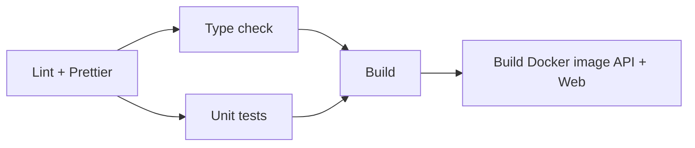

# Triển khai

## 1. Hạ tầng production

| Thành phần | Dịch vụ    | Địa chỉ                                | Ghi chú                                                                    |
| ---------- | ---------- | -------------------------------------- | -------------------------------------------------------------------------- |
| Web        | Vercel     | https://marketup-dien.vercel.app       | Tự deploy khi push lên `main`                                              |
| API        | Render     | https://marketup-u6cm.onrender.com/api | Tự deploy khi push lên `main`; có thể cold start sau lúc không có truy cập |
| Database   | Supabase   | PostgreSQL                             | API dùng kết nối pooler; migrate dùng kết nối trực tiếp                    |
| Ảnh        | Cloudinary | `res.cloudinary.com/<cloud>`           | Tài khoản production khác tài khoản dùng ở local                           |
| Email      | SMTP Gmail | App Password                           |                                                                            |
| App mobile | Capacitor  | WebView trỏ tới bản web production     | Không cần phát hành lại khi web thay đổi                                   |

## 2. Biến môi trường production

### Render (API)

| Biến                                                                                        | Giá trị                                                                          |
| ------------------------------------------------------------------------------------------- | -------------------------------------------------------------------------------- |
| `DATABASE_URL`                                                                              | Chuỗi kết nối pooler của Supabase                                                |
| `DIRECT_URL`                                                                                | Chuỗi kết nối trực tiếp của Supabase                                             |
| `JWT_SECRET`                                                                                | Chuỗi ngẫu nhiên ≥ 32 ký tự, chỉ dùng cho production                             |
| `JWT_EXPIRES_IN`                                                                            | Tuỳ chọn, mặc định `7d`                                                          |
| `CLOUDINARY_CLOUD_NAME`, `CLOUDINARY_API_KEY`, `CLOUDINARY_API_SECRET`, `CLOUDINARY_FOLDER` | Tài khoản Cloudinary production                                                  |
| `SMTP_HOST`, `SMTP_PORT`, `SMTP_USER`, `SMTP_PASS`, `SMTP_FROM`                             | Thiếu thì email không được gửi (chỉ ghi log)                                     |
| `FRONTEND_URL`                                                                              | `https://marketup-dien.vercel.app`, không có `/` ở cuối (CORS so khớp chính xác) |
| `TRUST_PROXY_HOPS`                                                                          | `3` (xem bên dưới)                                                               |
| `NODE_ENV`                                                                                  | `production`                                                                     |

Không bao giờ đặt `RATE_LIMIT_DISABLED` trên server.

### Vercel (web)

| Biến                  | Giá trị                                                   |
| --------------------- | --------------------------------------------------------- |
| `NEXT_PUBLIC_API_URL` | `https://marketup-u6cm.onrender.com/api`                  |
| `NEXT_PUBLIC_APP_URL` | Tuỳ chọn; mặc định lấy từ `VERCEL_PROJECT_PRODUCTION_URL` |

`NEXT_PUBLIC_*` được nhúng vào bundle lúc build: đổi giá trị thì phải deploy lại.

### TRUST_PROXY_HOPS

Request tới API trên Render đi qua chuỗi: client → Cloudflare → load balancer Render → sidecar, nên giá trị đúng hiện tại là `3`. Khi đổi hạ tầng, đo lại:

1. Mở `https://<api>/api/health/client-ip` trên trình duyệt.
2. So trường `ip` với IP thật của bạn (https://api.ipify.org).
3. Tăng hoặc giảm `TRUST_PROXY_HOPS` cho tới khi hai giá trị khớp.
4. Kiểm tra lại bằng một header `X-Forwarded-For` giả: `ip` vẫn phải là IP thật.

## 3. Quy trình phát hành

1. Chạy các bước kiểm tra như CI ở local (xem [Phát triển local § Kiểm tra code](development.md#6-kiểm-tra-code)).
2. Nếu có migration mới: **áp dụng migration lên production trước** (xem [Migration production](#migration-production)).
3. Push lên `main`. CI chạy; Render và Vercel tự deploy.
4. Khi thay đổi cả API lẫn web, API cần chạy bản mới trước khi web dùng tới endpoint mới.
5. Kiểm tra nhanh trên production: storefront, đăng nhập dashboard, `GET /api/shops/<slug>`.

### Migration production

Render **không** tự chạy migration. Code dùng cột mới mà DB chưa có cột đó sẽ làm API production lỗi ngay khi deploy.

Chạy từ máy local với chuỗi kết nối trực tiếp của Supabase đặt trong biến môi trường của phiên shell, **không** ghi vào `.env`:

```bash
# Xem migration nào chưa được áp dụng
DATABASE_URL="<direct-url>" DIRECT_URL="<direct-url>" \
  pnpm --filter @marketup/database exec prisma migrate status

# Áp dụng
DATABASE_URL="<direct-url>" DIRECT_URL="<direct-url>" \
  pnpm --filter @marketup/database exec prisma migrate deploy
```

- `migrate deploy` chỉ áp dụng migration đã có trong `migrations/`; không tạo migration mới và không xoá dữ liệu.
- **Không bao giờ** chạy `db:seed`, `db:push:force` hay `migrate dev` lên production: seed xoá toàn bộ dữ liệu.
- Migration có xoá cột hoặc đổi kiểu dữ liệu thì cần xem trước SQL trong `migration.sql` và sao lưu DB.

## 4. CI (GitHub Actions)

`.github/workflows/ci.yml` chạy khi push hoặc mở PR vào `main`/`develop`:



CI không deploy; Vercel và Render tự deploy từ `main`. Commit chỉ đổi format được liệt kê trong `.git-blame-ignore-revs`.

## 5. Tự host bằng Docker

`docker-compose.prod.yml` dựng PostgreSQL, API và web từ hai Dockerfile:

```bash
JWT_SECRET="<chuỗi ngẫu nhiên ≥ 32 ký tự>" docker compose -f docker-compose.prod.yml up -d --build
```

Lưu ý khi dùng:

- Compose không chạy migration. Sau khi Postgres lên, chạy `prisma migrate deploy` với `DATABASE_URL` trỏ tới container đó.
- Mật khẩu Postgres mặc định là `password`; đổi trước khi dùng thật.
- Image web không nhận `NEXT_PUBLIC_API_URL` lúc build, nên bundle dùng giá trị mặc định `http://localhost:3001/api`. Chỉ chạy đúng khi trình duyệt truy cập API qua `localhost:3001`.
