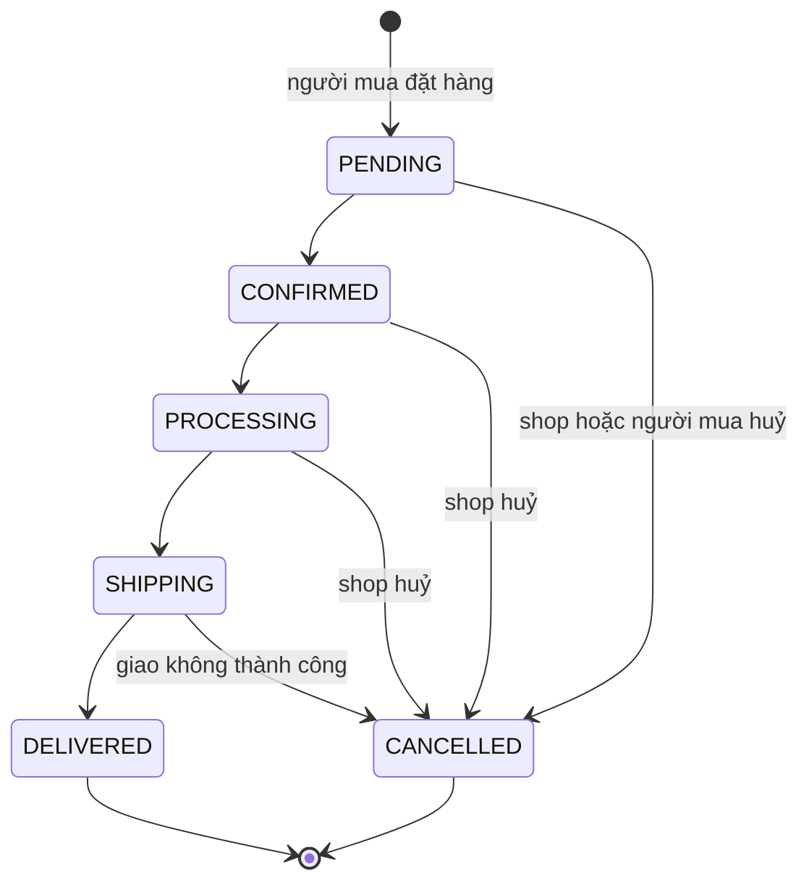

# Đặc tả sản phẩm

MarketUp cho phép một người bán tạo cửa hàng trực tuyến riêng (storefront) tại địa chỉ `/shop/<slug>` và quản lý nó qua dashboard. Người mua đặt hàng không cần tài khoản, thanh toán khi nhận hàng (COD).

## Định hướng sản phẩm

MarketUp là **"Shopify cho người bán nhỏ"**, không phải sàn thương mại điện tử kiểu Shopee.

- Mỗi shop là một cửa hàng độc lập, có thương hiệu riêng (slug, logo, banner, màu). Người bán tự đưa khách tới shop bằng link chia sẻ qua mạng xã hội, tin nhắn, bio…
- Người mua luôn ở **trong một shop**: giỏ hàng, checkout, đơn hàng, đăng nhập và tìm kiếm đều theo từng shop.
- **Không** làm các tính năng của sàn: trang chủ gom nhiều shop, tìm kiếm trên mọi shop, giỏ hàng gộp nhiều shop, so sánh giá giữa các shop, xếp hạng shop.
- Luật vòng đời đơn hàng (huỷ đơn có lý do, đánh giá từ đơn đã giao, shop không xoá được đánh giá) tham khảo Shopee, vì chúng giúp người mua tin tưởng một shop họ chưa từng mua. Các luật này không làm MarketUp thành sàn.

Khi cân nhắc tính năng mới, câu hỏi đầu tiên là: tính năng này phục vụ một shop và khách của shop đó, hay cần nhìn qua nhiều shop? Nếu cần nhìn qua nhiều shop thì nó nằm ngoài định hướng.

## 1. Vai trò

| Vai trò   | Cách xác thực                                                      | Làm được gì                                                                    |
| --------- | ------------------------------------------------------------------ | ------------------------------------------------------------------------------ |
| Khách     | Không                                                              | Xem storefront, sản phẩm, đánh giá; đặt hàng                                   |
| Người mua | Mã 6 số gửi qua email (phiên 30 ngày), hoặc link riêng của một đơn | Xem đơn của mình, huỷ đơn chưa xác nhận, đánh giá sản phẩm đã nhận             |
| Người bán | Email + mật khẩu (JWT)                                             | Quản lý một shop: sản phẩm, danh mục, đơn hàng, trả lời đánh giá, xem thống kê |

Mỗi tài khoản người bán sở hữu đúng một shop. Enum `Role` có giá trị `ADMIN` nhưng hiện chưa có tính năng quản trị nào dùng đến.

## 2. Người bán

### 2.1 Tài khoản và shop

- Đăng ký bằng tên, email, mật khẩu 6–72 ký tự. Email được chuyển về chữ thường.
- Sau khi đăng ký, người bán vào `/setup` để tạo shop: tên, slug, mô tả, màu chủ đạo, thông tin liên hệ.
- **Slug không đổi được sau khi tạo**, vì nó là địa chỉ storefront: đổi slug sẽ làm hỏng link đã chia sẻ và link trong email đơn hàng.
- Slug trùng → 409. Một người tạo shop thứ hai → 409.
- Logo và banner phải là ảnh đã upload lên Cloudinary của MarketUp (`https://res.cloudinary.com/<CLOUDINARY_CLOUD_NAME>/image/upload/…`) hoặc để trống. URL ngoài bị từ chối với lỗi 400.

### 2.2 Sản phẩm

- Sản phẩm có tên, mô tả, danh mục (tuỳ chọn, phải thuộc chính shop đó), ảnh, thuộc tính và biến thể.
- **Thuộc tính** (tối đa 10), ví dụ `Size: [S, M, L]`, `Color: [Black, White]`.
- **Biến thể** (tối đa 100): mỗi tổ hợp thuộc tính là một biến thể có giá, giá gốc để gạch (tuỳ chọn), tồn kho, SKU. Sản phẩm không có thuộc tính vẫn có một biến thể mặc định. Giá tối đa 9.999.999.999,99; tồn kho tối đa 1.000.000.
- **Ảnh**: tối đa 10 ảnh mỗi lần gửi, PNG/JPEG/WebP, mỗi ảnh ≤ 10 MB (quá cỡ → 413).
- **Ẩn/hiện** (`isVisible`): sản phẩm ẩn không xuất hiện trên storefront, trả 404 khi mở trực tiếp, không đặt được, và đánh giá của nó không được tính vào điểm shop.
- **Xoá**: sản phẩm đã từng có đơn chỉ bị ẩn (giữ lịch sử đơn); chưa có đơn thì xoá hẳn.

### 2.3 Danh mục

Danh mục thuộc từng shop, slug danh mục là duy nhất trong shop. Xoá danh mục thì sản phẩm của nó trở thành "không có danh mục".

### 2.4 Xử lý đơn hàng

Người bán chuyển trạng thái đơn theo đúng thứ tự (định nghĩa trong `apps/api/src/order/order-status.ts`):

- `DELIVERED` và `CANCELLED` là trạng thái cuối, không đổi được nữa.
- Chuyển sang `DELIVERED` thì ghi `deliveredAt`. Doanh thu chỉ tính từ đơn đã giao (COD).
- Đổi trạng thái là **có điều kiện**: API chỉ cập nhật nếu đơn vẫn ở trạng thái vừa đọc. Nếu người mua huỷ đúng lúc shop xác nhận thì chỉ một bên thành công, bên còn lại nhận 409 "This order was just updated".

### 2.5 Huỷ đơn

| Ai huỷ    | Khi nào                              | Lý do được chọn                                                |
| --------- | ------------------------------------ | -------------------------------------------------------------- |
| Người mua | Chỉ khi đơn còn `PENDING`            | `CHANGED_MIND`, `WRONG_DETAILS`, `FOUND_BETTER_PRICE`, `OTHER` |
| Shop      | `PENDING`, `CONFIRMED`, `PROCESSING` | `OUT_OF_STOCK`, `BUYER_UNREACHABLE`, `OTHER`                   |
| Shop      | `SHIPPING`                           | Chỉ `DELIVERY_FAILED` (ví dụ người mua từ chối nhận hàng COD)  |

- Bắt buộc chọn lý do; ghi chú tuỳ chọn, tối đa 500 ký tự.
- Sau khi shop xác nhận, người mua không tự huỷ được nữa mà phải liên hệ shop.
- Đơn bị huỷ lưu `cancelledAt`, `cancelledBy` (BUYER/SELLER), `cancelReason`, `cancelNote`; cả hai phía đều thấy ai huỷ và vì sao.
- Huỷ đơn **hoàn lại tồn kho** của từng biến thể, đúng một lần.
- Người mua nhận email báo huỷ.

### 2.6 Đánh giá

Người bán chỉ **xem và trả lời** đánh giá; không duyệt, ẩn hay xoá. Dashboard có bộ lọc theo số sao và "Needs reply", kèm số đánh giá chưa trả lời. Mỗi đánh giá hiển thị mã đơn và biến thể đã mua. Trả lời tối đa 1000 ký tự và có thể sửa lại.

### 2.7 Dashboard

- Tổng doanh thu (đơn `DELIVERED`), tổng số đơn, số đơn chờ xác nhận, số sản phẩm đang hiển thị.
- 5 đơn gần nhất.
- Biểu đồ doanh thu 7 ngày gần nhất, tính theo **ngày giao hàng giờ Việt Nam (UTC+7)**, không theo giờ server.

## 3. Người mua

### 3.1 Storefront

- `/shop/<slug>`: banner, logo, màu chủ đạo của shop, danh sách sản phẩm, tìm theo tên/mô tả và lọc theo danh mục (trong shop đó, xử lý trên trình duyệt), điểm đánh giá của shop và các đánh giá mới nhất.
- `/shop/<slug>/products/<id>`: thư viện ảnh, chọn biến thể (giá và tồn kho đổi theo), phân bố số sao, danh sách đánh giá.
- Storefront được render phía server (SSR) để link chia sẻ có tiêu đề, mô tả và ảnh xem trước.
- Shop không tồn tại hoặc ngừng hoạt động → trang 404 thật.

### 3.2 Giỏ hàng và đặt hàng

- Giỏ hàng lưu trong trình duyệt (`localStorage`, khoá `cart-storage`). Hiện là **một giỏ chung cho mọi shop** (xem mục 5).
- Checkout gồm: tên, email, số điện thoại, địa chỉ, thành phố, quận/huyện (tuỳ chọn), ghi chú (tuỳ chọn). Không cần tài khoản.
- Chỉ có thanh toán COD. Phí vận chuyển và giảm giá có cột trong DB nhưng hiện luôn bằng 0.
- Luật API kiểm tra khi tạo đơn:
  - 1–50 dòng; số lượng mỗi dòng là số nguyên 1–999; giới hạn thật là tồn kho.
  - Mỗi dòng phải chỉ đúng biến thể thuộc sản phẩm của shop đó và sản phẩm đang hiển thị, nếu không trả "Some items are no longer available".
  - Cùng một biến thể ở nhiều dòng được cộng dồn trước khi kiểm tra tồn kho.
  - **Trừ kho nguyên tử** trong transaction: chỉ trừ khi còn đủ hàng, nên hai đơn đặt cùng lúc không thể bán quá tồn kho.
  - Giá, tên, ảnh và nhãn biến thể được **chụp lại (snapshot)** vào đơn; sửa sản phẩm sau đó không làm đổi đơn cũ.
- Mã đơn dạng `ORD-251013-7K3QX9`: ngày đặt theo giờ Việt Nam + 6 ký tự ngẫu nhiên, bỏ các ký tự dễ nhầm (0/O, 1/I/L).
- Sau khi đặt, người mua được chuyển tới trang "đặt hàng thành công" có link xem đơn, và nhận email xác nhận kèm cùng link.

### 3.3 Xem đơn của mình

Có hai cách, không cần mật khẩu:

1. **Link riêng của đơn** (`/shop/<slug>/orders/<mã đơn>?t=<token>`): có trong mọi email đơn hàng và trang đặt hàng thành công. Link có hạn 180 ngày và chỉ mở đúng đơn đó: xem, huỷ khi còn `PENDING`, đánh giá sản phẩm. Link **không** phải phiên đăng nhập, vì bất kỳ ai cũng có thể gõ email người khác lúc đặt hàng.
2. **Đăng nhập bằng mã email** (`/shop/<slug>/orders`): nhập email → nhận mã 6 số → vào được danh sách mọi đơn của email đó trong shop, trên mọi thiết bị. Phiên có hạn 30 ngày.

Luật mã đăng nhập (`apps/api/src/buyer-auth/buyer-auth.service.ts`):

- Mã 6 số, hết hạn sau 10 phút, chỉ dùng một lần. DB chỉ lưu bản băm HMAC.
- Mỗi mã cho thử sai tối đa 5 lần; lượt thử được đếm nguyên tử trước khi so mã.
- Mỗi email: gửi lại sau ít nhất 60 giây, tối đa 5 mã mỗi giờ. Yêu cầu mã mới thì mã cũ hết hiệu lực.
- API luôn trả cùng một kiểu phản hồi dù email đã từng mua hay chưa, nên không dò được ai là khách của shop.
- Đơn không tồn tại và đơn của người khác trả cùng một lỗi 404.

Trang đơn hiển thị tiến trình trạng thái, thông tin giao hàng, sản phẩm, tổng tiền, ai huỷ và lý do (nếu có). Các trang đơn được đánh dấu `noindex`.

### 3.4 Đánh giá sản phẩm

Luật (`apps/api/src/review/review-rules.ts`, `review.service.ts`):

- Chỉ đánh giá được từ trang đơn hàng, với sản phẩm trong đơn **đã giao** (`DELIVERED`).
- Mỗi sản phẩm trong đơn (order item) tối đa một đánh giá. Mua lại ở đơn khác thì đánh giá tiếp được.
- Hạn viết là **30 ngày** sau `deliveredAt`. Trong hạn đó người mua **sửa được đúng một lần**.
- Nội dung: 1–5 sao, bình luận tuỳ chọn tối đa 2000 ký tự.
- Đăng ngay, không cần duyệt, có nhãn "Verified Purchase".
- Tên hiển thị được che từ tên người đặt hàng, ví dụ "Minh Tú" → "M\*\*\*ú". Email người mua không bao giờ xuất hiện trong đánh giá.
- Điểm shop là trung bình mọi đánh giá sản phẩm của shop; không có đánh giá riêng cho shop. Đánh giá của sản phẩm đang ẩn không được tính và không hiển thị công khai.

## 4. Email

Email gửi nền: lỗi SMTP được ghi log và không làm hỏng thao tác của người dùng. Nội dung email bằng tiếng Anh, dữ liệu người dùng được escape HTML.

| Sự kiện                      | Người nhận | Nội dung chính                             |
| ---------------------------- | ---------- | ------------------------------------------ |
| Đặt hàng                     | Người mua  | Xác nhận hoá đơn COD, link xem đơn         |
| Shop chuyển sang `SHIPPING`  | Người mua  | Đơn đang được giao, link xem đơn           |
| Shop chuyển sang `DELIVERED` | Người mua  | Đã giao, mời đánh giá (link tới trang đơn) |
| Đơn bị huỷ (bởi bất kỳ ai)   | Người mua  | Ai huỷ, lý do, link xem đơn                |
| Yêu cầu mã đăng nhập         | Người mua  | Mã 6 số, tên shop đang xem                 |

Nếu chưa cấu hình SMTP, API chạy ở chế độ mock: email được in ra log thay vì gửi. Riêng mã đăng nhập chỉ được in ra log khi `NODE_ENV` khác `production`.

## 5. Hạn chế đã biết và ngoài phạm vi

### Hạn chế đã biết

- **Giỏ hàng chung cho mọi shop**: thêm hàng ở shop A rồi sang shop B thì giỏ vẫn hiện hàng của A, và đặt hàng ở B sẽ bị API từ chối ("Some items are no longer available"). Cần tách giỏ theo shop.
- **Giá trong giỏ có thể cũ**: giỏ lưu giá lúc bấm "Add to Cart". Nếu shop đổi giá sau đó, checkout vẫn hiện giá cũ trong khi API tính theo giá hiện tại.
- **Giỏ không biết tồn kho**: tăng số lượng trong checkout không bị chặn theo tồn kho; chỉ khi đặt hàng API mới báo "Only N left".
- Tìm kiếm sản phẩm chạy trên trình duyệt với toàn bộ sản phẩm của shop; cần chuyển sang server (kèm phân trang) khi shop có nhiều sản phẩm. Các danh sách khác có giới hạn cứng: 100 đơn trong "My orders", 200 đánh giá ở dashboard.

### Ngoài phạm vi hiện tại

- Thanh toán online. Dependency `stripe` và biến môi trường mẫu có sẵn nhưng chưa có code tích hợp.
- Phí vận chuyển, mã giảm giá.
- Tính năng cho vai trò `ADMIN`.

### Không làm (trái định hướng)

- Tìm kiếm hoặc duyệt sản phẩm trên nhiều shop, trang chủ dạng sàn.
- Giỏ hàng hoặc checkout gộp nhiều shop.
